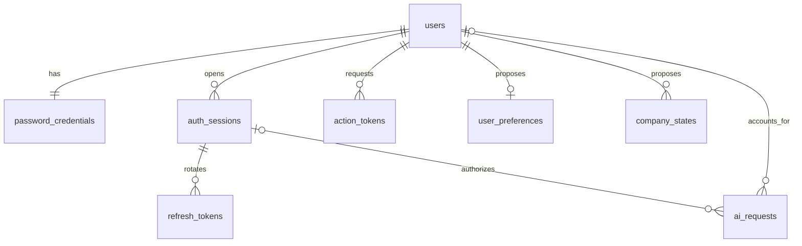

# Proposed PostgreSQL schema — issue #6

This proposal uses PostgreSQL 17+ and the supplied JSON company IDs. The authentication and AI-control tables below are implemented as prerequisites for #8 and #12. Preference syncing and company-state APIs remain #6 work; their tables below are proposed, not silently enabled.

| Table                         | Main columns                                                                                                                         | Relationship and purpose                                                                                              |
| ----------------------------- | ------------------------------------------------------------------------------------------------------------------------------------ | --------------------------------------------------------------------------------------------------------------------- |
| `users`                       | UUID `id`, normalized unique `email`, `email_verified_at`, `auth_version`, `ai_enabled`, timestamps                                  | Stable account identity. AI access defaults off.                                                                      |
| `password_credentials`        | PK/FK `user_id`, `password_hash`, `updated_at`                                                                                       | One salted Argon2id password credential per user; cascade deletion.                                                   |
| `auth_sessions`               | UUID `id`, `user_id`, `auth_version`, `created_at`, `expires_at`, `revoked_at`                                                       | Each login creates a separately revocable session. Checked on every authenticated request.                            |
| `refresh_tokens`              | PK `token_hash`, `session_id`, `expires_at`, `used_at`                                                                               | Single-use rotating tokens. Consumed tokens remain until their family expires so replay is detectable.                |
| `action_tokens`               | PK `token_hash`, `user_id`, `purpose`, `expires_at`, `consumed_at`                                                                   | Purpose-bound, single-use email verification and password reset. Hashes only; raw tokens go only to the user's email. |
| `user_preferences` (proposed) | PK/FK `user_id`, `theme`, `city`, `company_type`, `industry`, `opportunity`, `updated_at`                                            | One preference row per user. Validate filters against the current company catalog.                                    |
| `company_states` (proposed)   | composite PK (`user_id`, `company_id`), `state`, timestamps                                                                          | `state` is `saved` or `passed`; the same company cannot be both for one user.                                         |
| `rate_limits`                 | opaque `bucket`, `attempts`, `expires_at`                                                                                            | Shared fixed-window limits. HMAC identifiers; no raw IP or email stored.                                              |
| `ai_policy`                   | singleton row, enabled/model, token prices, daily/monthly budgets, user limits, concurrency/output caps                              | Operator-controlled, shared kill switch and pricing/limits. Defaults disabled.                                        |
| `ai_requests`                 | UUID `id`, user/session references, idempotency UUID, task/model/state, token/cost reservations and charges, lease/finish timestamps | Content-free accounting ledger. No resume, resume fingerprint, prompt, model output, password, or API key columns.    |



## Proposed preference DDL

These tables are deliberately outside migration 001 until #6's sync/import behavior is reviewed:

```sql
CREATE TABLE user_preferences (
  user_id uuid PRIMARY KEY REFERENCES users(id) ON DELETE CASCADE,
  theme text NOT NULL DEFAULT 'light' CHECK (theme IN ('light', 'dark')),
  city text NOT NULL DEFAULT '',
  company_type text NOT NULL DEFAULT '',
  industry text NOT NULL DEFAULT '',
  opportunity text NOT NULL DEFAULT '',
  updated_at timestamptz NOT NULL DEFAULT now()
);

CREATE TABLE company_states (
  user_id uuid NOT NULL REFERENCES users(id) ON DELETE CASCADE,
  company_id text NOT NULL CHECK (length(company_id) BETWEEN 1 AND 128),
  state text NOT NULL CHECK (state IN ('saved', 'passed')),
  created_at timestamptz NOT NULL DEFAULT now(),
  updated_at timestamptz NOT NULL DEFAULT now(),
  PRIMARY KEY (user_id, company_id)
);
CREATE INDEX company_states_collection_idx ON company_states(user_id, state);
```

Company IDs currently reference versioned `src/research-data/kern-county.json`, so validate them server-side. Add a catalog table and a real foreign key if company editing moves into PostgreSQL. Programs, resources, and unverified leads must not become saved employer records accidentally.

## Ownership, deletion and retention

- Derive `user_id` exclusively from the validated session; do not accept a caller-selected owner. Bind all SQL values and scope every read/write/delete to that identity.
- Consider row-level security as a second boundary when #6 adds collection endpoints. Verify pool/role behavior instead of assuming an ORM enables isolation.
- Use an application role without superuser/DDL rights, a separate migration role, private networking and verified TLS for nonlocal connections.
- Delete credentials, sessions, refresh/action tokens, and future preference/company-state rows with the user. AI accounting references become null so deleting an account cannot erase shared spending reservations.
- Prune expired rate buckets and tokens; retain content-free AI accounting/idempotency records for 35 days. The model accounting window is UTC request admission, not a promise about the provider's invoice timing.
- Do not add resume storage or user-provided LLM key columns. They require a separate opt-in, encryption, access, and deletion design.
- Guest preferences remain local. Signed-in collection syncing and an explicit reviewed guest import are still #6 scope.

## Acceptance before completing #6

Add the two proposed tables through a reviewed migration, implement authenticated per-user CRUD and explicit guest import, validate catalog IDs/filters, and test A/B account isolation, constraints, races, clearing, deletion and cross-device restoration against PostgreSQL. This proposal and the #8/#12 prerequisites do not complete the entire account-persistence issue.
